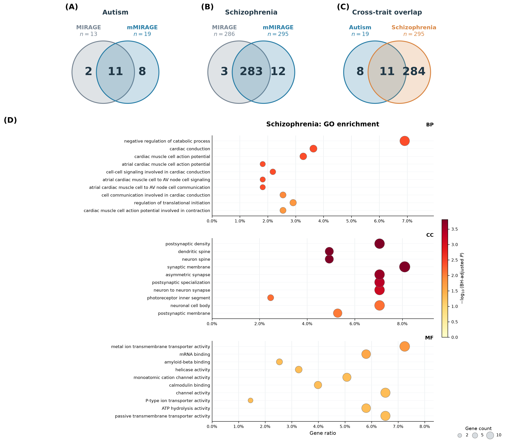

# Autism and schizophrenia analysis

The exploratory analysis uses ASC autism and SCHEMA schizophrenia exome
case-control summaries, retaining study-specific pooled AF at most 0.1% and
SCHEMA inclusion flags. There are 406,842 ASC variants in 17,581 genes and
686,383 SCHEMA variants in 18,009 genes; the joint universe contains 19,030 genes.

Functional groups are loss-of-function variants in LOEUF decile 1, deciles 2–3,
and deciles 4–10, and missense variants with MPC at least 2, between 1 and 2,
and below 1. The Gamma mean is 6 for loss-of-function and 3 for missense, with
rate 2. Fixed study exposures are maximum retained case/control allele numbers:
22,960/21,632 for ASC and 174,398/295,270 for SCHEMA. These are allele-number
exposures, not reported participant counts.

The schizophrenia marginal risk-gene proportion is fixed at 5% for both
single-trait and joint fits. Current parameter estimates use the stricter
convergence thresholds 1e-8 (parameters) and 1e-10 (relative likelihood).
Boundary autism eta estimates remain a limitation.

## Results

| Method | Autism | Schizophrenia |
|---|---:|---:|
| Single-trait MIRAGE | 13 | 286 |
| Joint mMIRAGE | 19 | 295 |

Discoveries use nominal 5% Bayesian FDR. The shared-risk posterior selects eight
genes. The intersection of the two marginal joint lists is 11; these are distinct
selection criteria. GO term counts (BP/CC/MF) are 76/3/15 for autism, 17/18/12
for schizophrenia and 18/13/0 for shared-risk genes. Larger discovery counts and
GO enrichment do not independently establish power or calibration.

## Interpretation limits

The original input preparation used different study genome builds and joined
variant coordinates without liftover. Numerical convergence does not resolve
this harmonization issue. The results remain exploratory pending corrected
input preparation and reanalysis. The fixed risk proportion and boundary eta
estimates also require sensitivity assessment; posterior calibration has not
been established.

Only aggregate summaries and the current figure are distributed; raw study
inputs and per-gene posterior datasets are not included.
