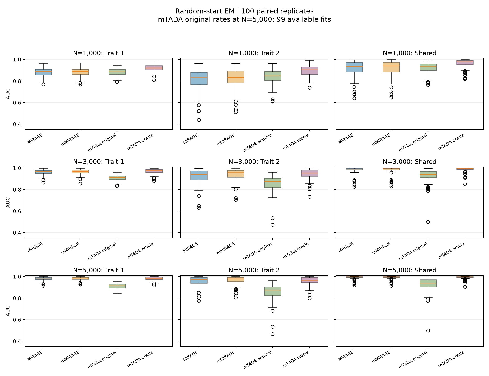
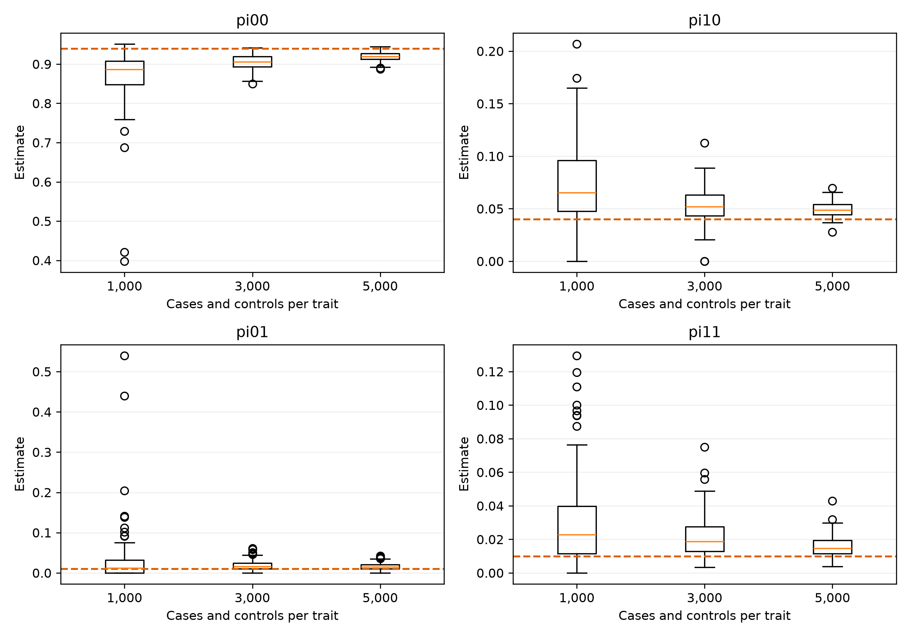

# Simulation

The current comparison uses 500 genes and 100 variants per gene per trait.
Each trait has N cases and N controls, with N=1000, 3000 or 5000. There are 100
paired replicates per setting, sharing latent parameters across sample sizes
and generating count increments independently as sample size increases.

Each replicate randomly assigns exactly 470, 20, 5 and 5 genes to states
(00, 10, 01, 11), corresponding to proportions (0.94, 0.04, 0.01, 0.01). Annotation probabilities are (0.60, 0.30, 0.10).
Variant inclusion probabilities in risk genes are (0.05, 0.20, 0.50) for trait 1
and (0.03, 0.15, 0.40) for trait 2. Annotation-specific Gamma relative-risk means
are (3, 3, 5), with rate one.

Baseline frequencies are `q = min(0.04*B, 0.01)` with
`B ~ Beta(0.35,80)`. Independently, `H ~ Bernoulli(0.05)` and the
case/control count-generating rate is `min(q*(1+4*H), 0.05)`. Counts are Poisson with exposure 2N,
with relative risk multiplying the case rate. The simulation does not impose
the real-data pooled-AF filter. The analysis uses the conditional binomial
working likelihood; integrating a Gamma prior in that likelihood is not the
exact conditional distribution of this random-effect Poisson data generator.

Both joint mMIRAGE and single-trait MIRAGE use integrated variant BFs, five
random EM starts and the highest final likelihood. Stops require maximum
parameter change below 1e-6 and relative likelihood change below 1e-8, with a
10,000-iteration limit. Single-trait shared scores multiply marginal posteriors.

The aggregated mTADA comparator uses pre-multiplier rates or true count-generating
rates (oracle), and receives true marginal gene-risk proportions 0.05 and 0.02.
At N=5000 the original-rate comparator has 99 available fits. Its input
information differs from mMIRAGE. Variational diagnostic warnings occurred in
189 of 600 mTADA fits.

## Results

The [summary tables](../results/simulation/) report AUC, average precision,
empirical FDP, discoveries, paired comparisons, parameter recovery and selected
fit convergence. Selected joint EM fits met stopping criteria in 98/100,
100/100 and 100/100 replicates for increasing N. Numerical stopping does not
imply that the new KKT or curvature checks have been applied retrospectively.

At N=3000, joint AUCs are 0.9643, 0.9377 and 0.9818 for trait 1, trait 2 and
shared risk. Mean empirical FDPs at nominal 5% Bayesian FDR are 9.50%, 9.08%
and 10.82%; calibration limitations remain. No uniform advantage over all
comparators and targets is claimed.

The repository distributes aggregate summaries and figure assets, not the bulk
per-replicate datasets or development runs. These tables are existing results,
not a new simulation run.
